# Oman Events Radar

An open, **rule-based** (no AI) radar of business, technology and startup events in Oman — refreshed every day so teams can plan their posts weeks ahead instead of discovering events the day before.

**Live calendar:** `https://maith98.github.io/oman-events-radar/` · **Subscribe:** `events.ics` (events) and `posts.ics` (content workflow)

<p align="center">
  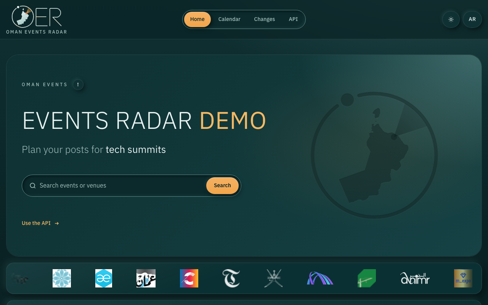
  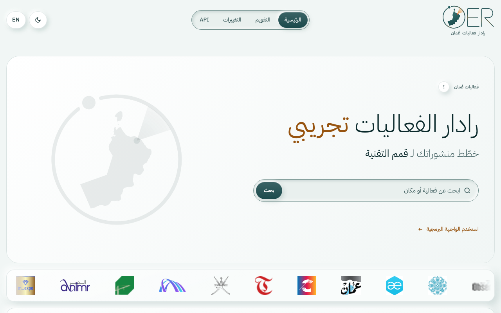
</p>

### ▶ Watch the 45-second tour

[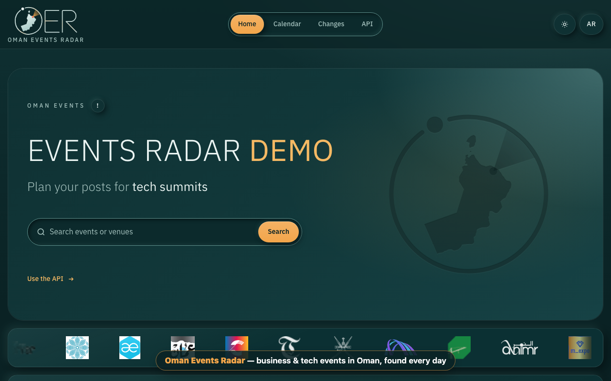](assets/readme/oman-events-radar-tour.mp4)

*Click the picture to open the video (MP4, 45 s, no sound). It walks through every page of the [demo website](#demo-website) with captions.*

**Contents:** [What it does](#what-it-does) · [How to use it](#how-to-use-it) · [Screenshots](#screenshots) · [Outputs](#outputs-docs-served-by-github-pages) · [Demo website](#demo-website) · [Add an event](#add-an-event) · [Run it](#run-it)

## What it does

```
FETCH → DISCOVER → NORMALISE → FILTER → DE-DUPLICATE → SCORE → VERIFY → DIFF → PUBLISH → NOTIFY
```

| Step | Rule (always deterministic) |
|---|---|
| Fetch | Venue calendars (OCEC), organiser sites (CONNECT, Arabian Research Bureau/OITE, Al Nimr, Oman Expo, MTCIT), official event sites, aggregators (allevents, Eventbrite), Omani news RSS (EN + AR), the team seed list and community submissions |
| Discover | Every official website seen on an event or organiser is probed once a week for schema.org `Event` data and becomes a source automatically — one hop only, never a crawl of the whole web |
| Filter | Spam keyword blocklist; always-on aggregator listings longer than 45 days are dropped |
| De-duplicate | Same core title + start within 3 days, or within 14 days *and* same venue/organiser; different years in the titles never merge |
| Score | Keyword weights per category (title counts double, description only adds "core" words). Geography is a separate `region` field (Oman / GCC / Other) |
| Verify | Trust tiers A (venue/organiser/government) 70 · B (official event site, maintainer-approved) 60 · C (aggregator) 40 · D (news, page-watch, prediction) 25; +25 when an independent source agrees. ≥ 60 → team calendar, 40–59 → review queue, < 40 → lead |
| Recurrence | A past High/Medium event with no announced next edition creates an *Expected – confirm* entry 364 days later |
| Workflow | High: brief T-21 · announce T-14 · design lock T-7 · reminder T-3 · live T · recap T+1. Medium: brief T-10 · announce T-7 · reminder T-2. Low: calendar only |
| Diff | Stable event ids (a rescheduled event keeps its id), versioned change feed, tombstones instead of silent deletion |

Politeness and safety: `robots.txt` and crawl-delay are honoured on every request (Google News search and Meetup search disallow crawlers, so they are not used); only public `http(s)` addresses are fetched (SSRF guard, re-checked on redirects); responses are capped at 5 MB. LinkedIn, Instagram and X are **not** scraped — hashtags are used as keyword filters on permitted sources and as suggested hashtags for posts.

## How to use it

Three short tutorials, one per job. Each GIF is a few seconds long and loops.

### 1. Plan your posts for an event

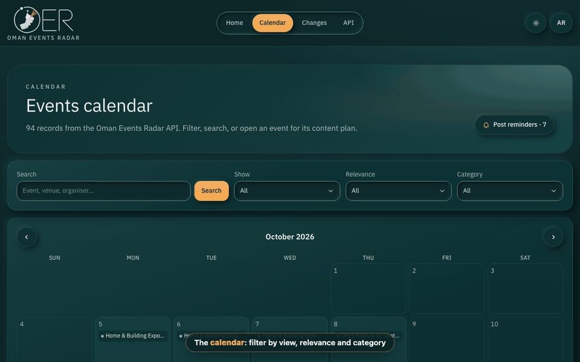

1. Open **Calendar**. The first visit each session opens **Post reminders**: every post that must be ready in the next 14 days, soonest first (it reopens from the bell button).
2. Narrow the list with **Show**, **Relevance** and **Category**, or search by event, venue or organiser. The filters live in the URL, so a filtered view can be shared as a link.
3. Open an event. Its **content plan** lists the post dates for its relevance: High → brief T-21 · announce T-14 · design lock T-7 · reminder T-3 · live · recap T+1; Medium → brief T-10 · announce T-7 · reminder T-2.
4. Prefer your own calendar? Subscribe to `posts.ics` (post deadlines) and `events.ics` (events) in Google Calendar or Outlook — the radar updates them every morning and calendar apps pick up the changes on their own schedule.

### 2. Find events

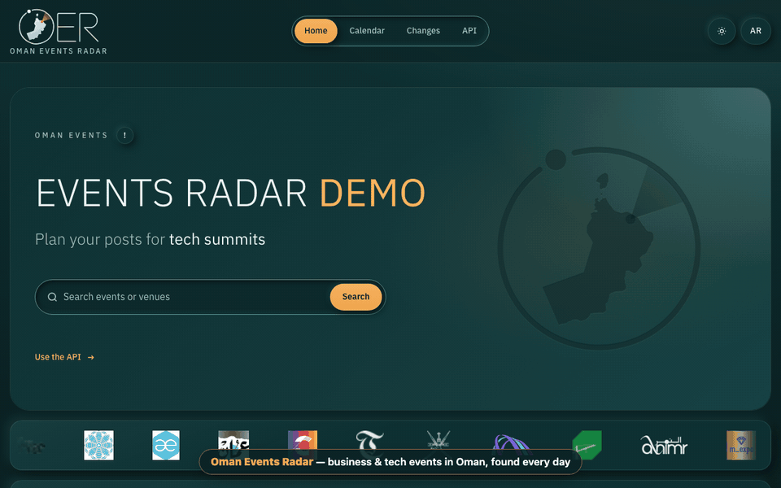

1. **Home** shows the venue map: zoom, jump to a governorate or city with **Go to…**, switch between venues and events, or open the list. *Locate me* sorts by distance (your location stays in your browser).
2. **Search** from the hero looks through events, news, venues and organisers, with each result's own picture.
3. **News** lays out event stories from Omani newspapers as a front page; when the radar found the event's date in a story, it is shown with it.

### 3. Connect a system (API)

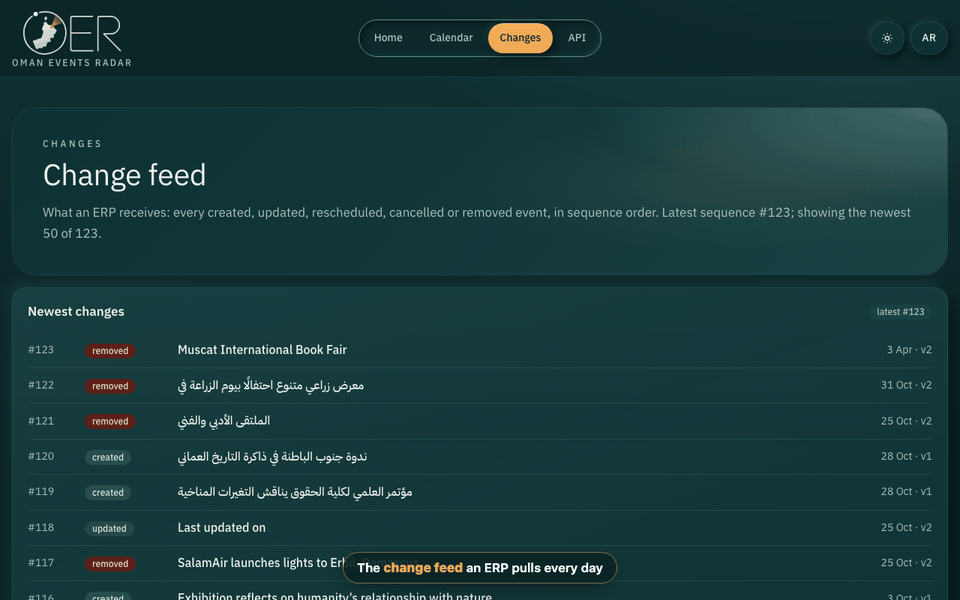

1. Every output is a static file — no key, no sign-up: `https://maith98.github.io/oman-events-radar/events.json`.
2. To keep an ERP or a database in sync, pull **`changes.json`** daily and apply entries with a `sequence` higher than the last one you stored — or receive them as a signed webhook. See [`docs/INTEGRATION.md`](docs/INTEGRATION.md).
3. The demo's **API** pages document every endpoint and field, with code in curl, JavaScript, Python and PHP, and a *Try it live* box.

```bash
curl -s https://maith98.github.io/oman-events-radar/events.json \
  | jq '.events[] | select(.status == "Upcoming" and .relevance == "High") | {title, start, end, venue}'
```

## Screenshots

| | |
|---|---|
| 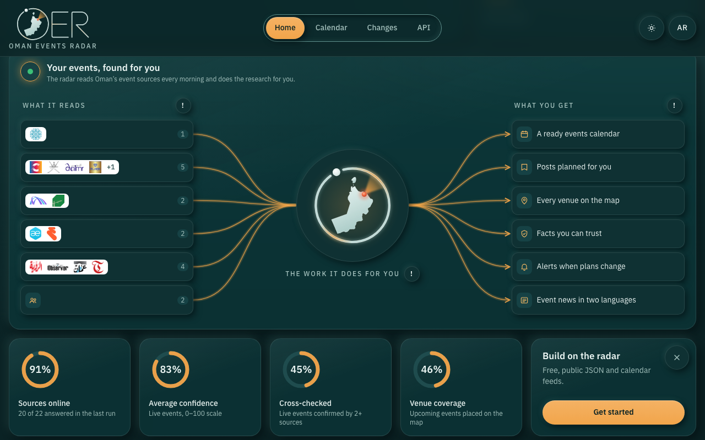 **How it works** — sources (by their logos) → the radar → ready results, with live health gauges | 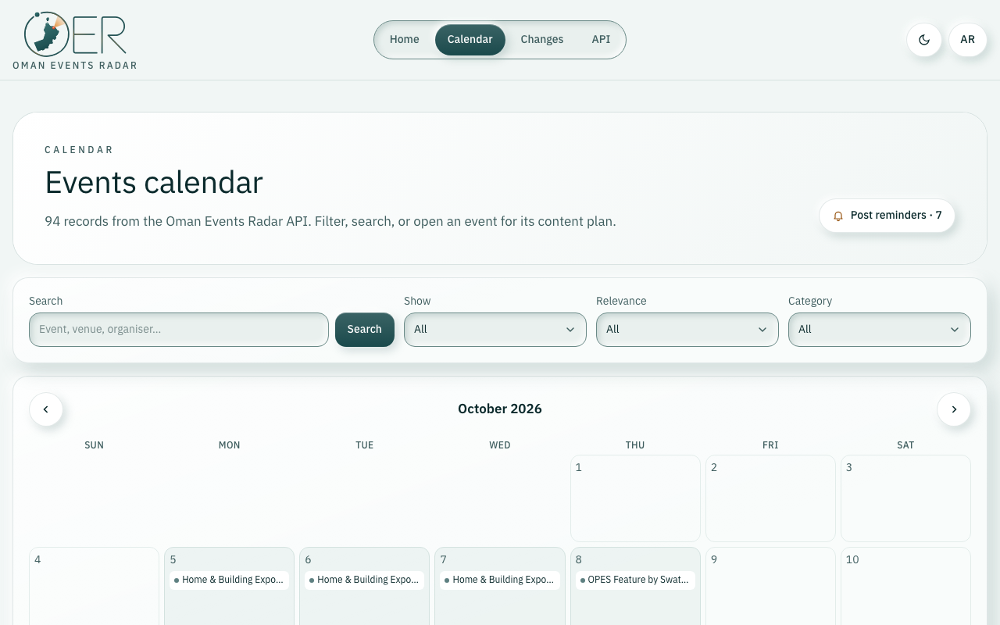 **Calendar** — filters, month grid and an agenda of equal cards |
| 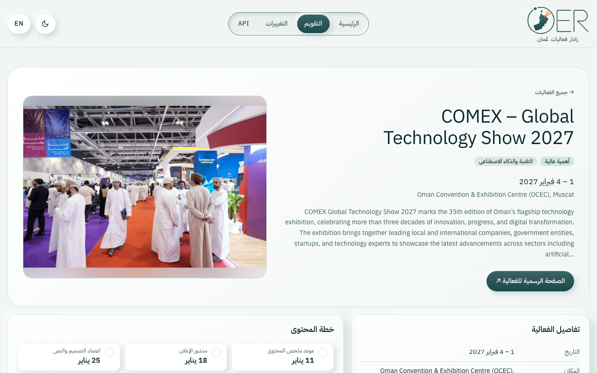 **Event page** (Arabic) — picture, details, content plan, hashtags, change history | 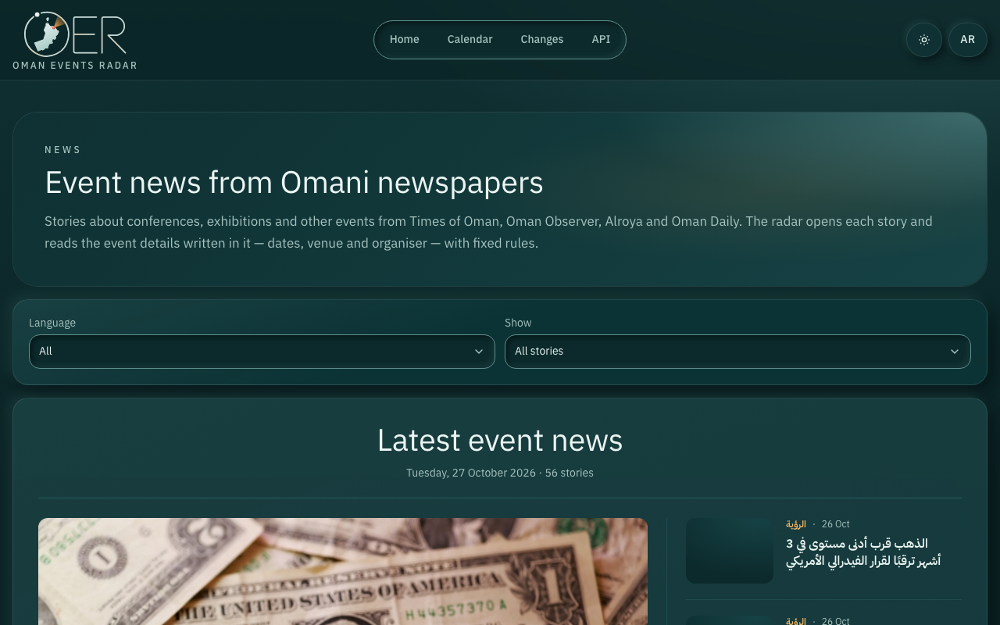 **News** — Omani event stories as a newspaper front page |
| 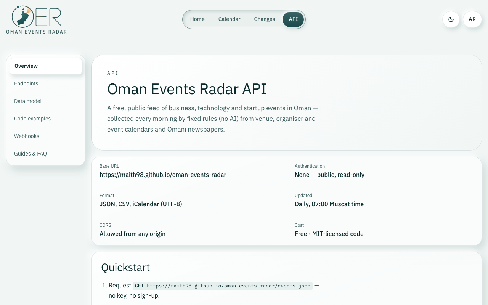 **API docs** — endpoints, data model, examples, webhooks, guides |  **Arabic & English, light & dark** — every page, right-to-left aware |

## Outputs (`docs/`, served by GitHub Pages)

| File | For |
|---|---|
| `index.html` | Team calendar: filters, review queue, expected editions, copy-hashtags |
| `events.csv` | Same columns as the team's events sheet, plus workflow dates, region, confidence |
| `events.ics` / `posts.ics` | Subscribe in Google Calendar / Outlook |
| `events.json` | Full records (schema below) |
| `changes.json` | Change feed for systems such as an ERP (see [`docs/INTEGRATION.md`](docs/INTEGRATION.md)) |
| `news.json` | Event stories from Omani newspapers (EN + AR): `title`, `url`, `source`, `lang`, `published`, `summary`; `event` (name, start, end, venue, organizer, and `matched_event_id` when it matches a calendar record) when the story gives a date; `also` lists other papers' stories about the same event |
| `leads.json` | Undated announcements and items waiting for review |
| `watchlist.json` | Health of every source, venue, organiser and discovered site |

## Demo website

[`demo/`](demo/) is a full website built on this API — the one in the screenshots and the video: home with the venue map and the automation, search, calendar with post reminders, event pages, news, change feed and the API documentation, in Arabic and English with light and dark themes.

```bash
cd demo
npm install
npm run dev        # http://localhost:5173
npm test           # unit tests (SSRF guard, preferences, media cache)
npm run build && npm start   # production build
```

It reads the public API at request time (cached for 5 minutes) and needs no keys. Event and news pictures are fetched live from each item's own page by the server — only pages the radar already links to, through a hardened fetcher (public addresses only, checked again on every connection and redirect, size and time limits) — and are never stored. Details: [`demo/README.md`](demo/README.md).

## Add an event

- **Easiest:** open an issue with the *Add an event* form, or comment the link on our LinkedIn post — a maintainer adds it.
- **Pull request:** add a row to [`community/submissions.csv`](community/submissions.csv). A row with only the `WEBSITE` column is enough when that page publishes schema.org event data.

Submissions are leads until a maintainer merges them. Only public information — no personal phone numbers or emails.

## Add a source, venue or organiser

Edit [`sources.json`](sources.json): `sources` for feeds, `watch.venues` / `watch.organisers` for places and organisers to follow. Supported types: `ical`, `wp_tribe`, `jsonld`, `rss_leads`, `page_watch`, `csv`. See [CONTRIBUTING.md](CONTRIBUTING.md).

## Run it

```bash
python3 -m radar                 # full run (Python 3.10+, no dependencies)
python3 -m radar --offline       # only local CSV files
python3 -m unittest discover -s tests
```

The GitHub Action in `.github/workflows/daily.yml` runs every day at 07:00 Muscat time and commits the refreshed files.

## Licence

MIT — see [LICENSE](LICENSE). Event facts belong to their organisers; we link to the official page for every event.
